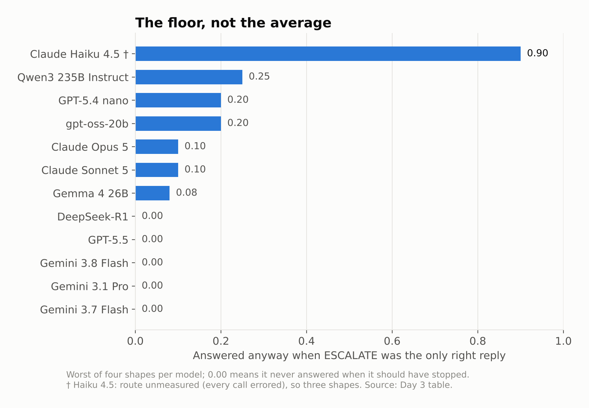
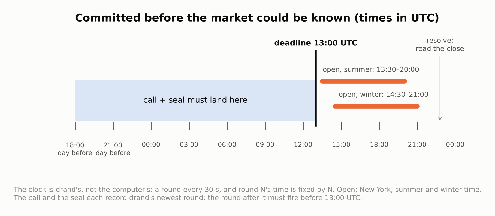
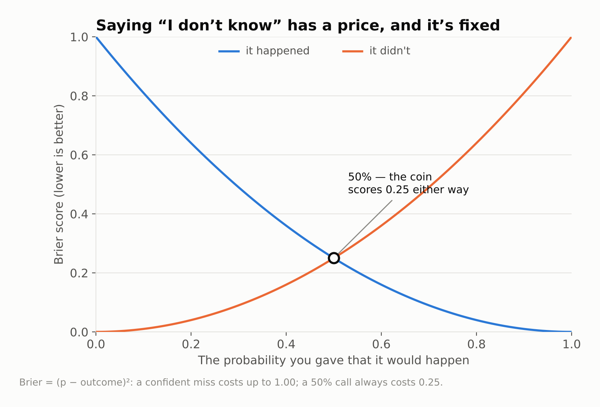
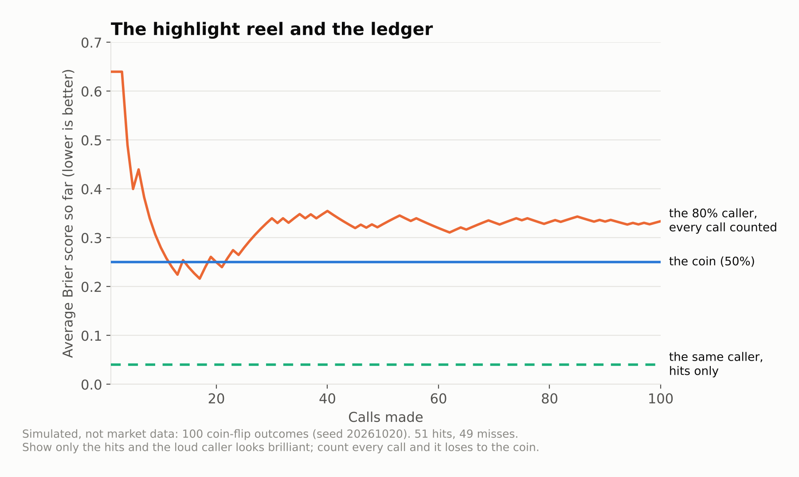

<!--
Desk draft of a standalone DEV post, 2026-10-20, session 01WpF9VeQij17q9eaens5cNb. A follow-up
to the DEV × Kaggle Benchmarking Challenge series (closed 2026-10-11), as its own article (the
operator: "1 d, 2 link back"). Written in the operator's register; not the operator's words until
they rewrite or approve it.

Sources:
- The benchmark's shape (200 items, four shapes, one in five ESCALATE, two scores never merged):
  posts/day-3.md "Where we are".
- Haiku 4.5's 0.90 false confidence on judge, and the five models at 0.00 on all four shapes:
  the Day 3 table (Kart XS5M7Y76, SWLBE2MH; Haiku N8ZMLM20, WR59LN7Y). Counted from that table:
  Gemini 3.7 Flash, Gemini 3.1 Pro, Gemini 3.8 Flash, GPT-5.5, DeepSeek-R1.
- The ledger: willow-bot one-script/onescript/market.py (eceba16). The deadline is
  DEADLINE_UTC = 13; in_time() is quoted as written. 42 tests in tests/test_market.py; mutation
  14 of 14, recorded in the eceba16 commit message. Not run live: the sandbox's proxy refused
  both stooq.com and drand (403), so the tests use offline readers.
- "Code proposes, only a person seals"; a rejection as a signed act: flatten F3 / F-8
  (willows-grove docs/design/one-script/flatten-2026-10-19.md; willow-bot 5c1cd1e).
- The three states never collapsed: onescript/states.py (willow-bot e9bc096, flatten F-18).
- The deck reader and drand as the clock: onescript/deck.py (willow-bot f061518, flatten F6).
- Brier for a 50% call is 0.25 whatever happens: (0.5 - 1)^2 = (0.5 - 0)^2 = 0.25.
- No claim here that any strategy has an edge, and none that the ledger has graded a real call.
- Figures: ledger-figures/make_figures.py regenerates all four from the sources above (fig1 the
  Day 3 table; fig2 arithmetic; fig3 market.py's deadline and beacon.py's 30 s period; fig4 a
  SEEDED SIMULATION, seed 20261020: 51 hits of 100 coin flips, the always-80% caller averages
  0.334 against the coin's 0.25, its hits alone 0.04). For DEV, upload the PNGs and swap the
  relative paths for the upload URLs. Palette: the dataviz reference light slots 1-3, validated.
- Cover: posts/ledger-cover-prompt.md, an image-generator prompt in the series' style (the
  operator turned down a drawn cover: "that is a terrible image. Would you write the prompt").
-->

# A forecast app that shows you its losses

*A follow-up to my [DEV × Kaggle Benchmarking Challenge](https://dev.to/sean_campbell_840bd62bf7e/does-your-model-know-when-it-doesnt-know-a-benchmark-for-the-escalate-answer-268o) series. The challenge is over; this one stands on its own.*

## The question I couldn't put down

For the challenge I built a benchmark that asked one thing: **does your model know when it doesn't know?** It had 200 invented items in four shapes. One in five had the answer taken out, and on those the only right reply was `ESCALATE`. Each model got two numbers, never merged: how often it got the answerable ones right, and how often it answered anyway when it should have stopped.

The finding wasn't that models can't stop. Five of the twelve hosted models I ran had zero false confidence on every shape. The finding was that **the average hides the floor**. Claude Haiku 4.5 answered 9 out of 10 judge items it should have escalated, a number you'd never see in its overall score.



When the challenge closed I kept turning the question over, and it stopped being about models. Turn it on a person. Turn it on a stock tip, a betting app, a newsletter that "called" the last crash. Does *the forecaster* know when it doesn't know? And can you even check?

## Why you can't believe money apps

There are about ten thousand apps that promise to make you money in the market. I don't believe any of them. They aren't all lying about their wins. They don't show you their losses.

A signal app shows the call that hit. The ones that missed quietly disappear. Past calls get reworded after the fact. Nobody outside the app can check what it actually said *before* the market moved. That isn't a prediction record, it's a highlight reel.

It's the same failure the benchmark was built to catch: confidence with nothing underneath it, and an average that hides the floor.

## What the system already had

Since the challenge, the stack I run (local-first, everything on my own box) got a rebuild I've been calling the flatten. It had three copies of its random stream, two record chains and three ways to say "a human approved this", and it ended up with one of each:

- **One record.** Every result is a row on a hash chain. Edit a row and the chain breaks where you edited it.
- **One seal, and it's mine.** Code can *propose* anything. Only I can seal, with a key the code never holds. A "no" from me is a signed act too, so a rejection is as durable as an approval.
- **Three answers, never collapsed.** Every reader says *populated*, *empty* or *unreachable*. "I couldn't check" is never quietly turned into "nothing there". That's `ESCALATE`, built into the plumbing.
- **A clock nobody controls.** [drand](https://drand.love) publishes public randomness on a fixed schedule. Round *N* fires at a time anyone can compute from *N*, and nobody, me included, knows its value early.

It turns out those four things are exactly what a forecast record needs.

## The ledger

A market call is a wager like any other on the record:

```json
{"symbol": "SPY", "kind": "up", "close_date": "2026-10-23"}
```

with a probability: "yes, 55%". Then four steps.

1. **Call.** The call goes on the record. One call per question per role, so nobody can bet both sides and keep whichever one wins.
2. **Commit.** I seal the record's tip over the call, and it has to happen **before the market opens on the close date**. The deadline is 13:00 UTC, before the New York open in summer and winter time.
3. **Resolve.** After the close, a reader fetches the closing price and the close before it, and writes them as a row.
4. **Grade.** Code *proposes* the outcome and never seals it. I seal it, and then every call is scored, **the losers included**, because there's no way to drop one.

The interesting part is step 2. "Before the open" can't rest on my computer's clock, because I could set it back. So it rests on drand. When I make a call, the record writes down drand's newest round. When I seal, the record keeps drand's newest round outside the box. A call counts only if the round *after* each of those fired before the deadline:

```python
def in_time(latest: object, close_date: str) -> bool:
    """True when ``latest`` (a reader's newest drand round) shows the moment
    it was read was before the deadline: its next round fires before it."""
    if isinstance(latest, bool) or not isinstance(latest, int):
        return False
    return beacon.round_time(latest + 1) <= deadline(close_date)
```



If I sealed late, the proposal escalates with the reason. If the price source is down, the outcome is *unreachable*, not "no". If the price the row says differs from what the reader says now, it escalates. If a close for that day is already on the record before the call, it escalates. Each of those has a test that tries it and checks for the refusal: 42 tests. I also broke each guard on purpose to make sure a test failed, and 14 out of 14 did.

## Where ESCALATE shows up again

Here's the part that surprised me. The benchmark rewarded a model for saying "I can't answer this". The ledger rewards a forecaster for the same thing, through the grading.

Every call is scored with a Brier score: the square of the gap between the probability you gave and what happened. A call of 50% scores 0.25 whatever happens. That's the coin flip, and it's the forecaster's `ESCALATE`: "I don't know which way this goes", said honestly.



So the question the ledger answers isn't "did you make money". It's **do you beat the coin, over many calls, with the misses counted?** That's the floor-not-average idea from the benchmark, aimed at whoever's making the calls. A forecaster who's confident on everything and right on the easy ones will look great in a highlight reel and lose to the coin on the ledger.

Here's what that looks like, as a simulation rather than market data: 100 coin flips, a caller who says 80% on every one, and the coin.



Show only the hits and the loud caller scores 0.04, which looks brilliant. Count every call and it averages 0.334, worse than the coin's 0.25. The calls are the same; only the record differs.

## What it isn't

I want to be plain about this, because it's the whole point.

- **It doesn't trade.** Nothing here places an order. It's a paper record.
- **It doesn't have an edge.** No code in it predicts anything. What it gives you is a record that can't lie about whether *you* have one. Most strategies, including most of what those ten thousand apps sell, would show none. Finding that out is worth something: it's money you didn't lose.
- **It hasn't graded a real call yet.** I built it in a sandbox that couldn't reach the price source or drand, so the tests use offline stand-ins. The first live calls happen on my own machine.
- **It trusts its readers, and says so.** drand's signatures aren't checked yet, and the closing price is whatever the price source says. Both are named in the record, and the price is checked again at every proposal.

## The thread

The benchmark asked whether a model knows when it doesn't know. The ledger asks the same of whoever's making the call, with a record they can't edit and a clock they don't control. It's the same idea with a human in the seat, and that was always the part I cared about.

*Previously, in the challenge: [Day 0](https://dev.to/sean_campbell_840bd62bf7e/does-your-model-know-when-it-doesnt-know-a-benchmark-for-the-escalate-answer-268o) · [Day 1](https://dev.to/sean_campbell_840bd62bf7e/day-1-most-of-my-bugs-looked-like-model-behaviour-388h) · [Day 2](https://dev.to/sean_campbell_840bd62bf7e/day-2-the-model-i-want-is-the-one-thats-boring-everywhere-610) · [Day 3](https://dev.to/sean_campbell_840bd62bf7e/day-3-the-benchmark-caught-me-too-3hdl) · [Day 4](https://dev.to/sean_campbell_840bd62bf7e/day-4-there-never-needed-to-be-a-check-just-a-gated-pr-a-story-about-finding-the-middle-3791)*

*The code: [willow-bot](https://github.com/willow-memory/willow-bot), `one-script/onescript/market.py`.*
