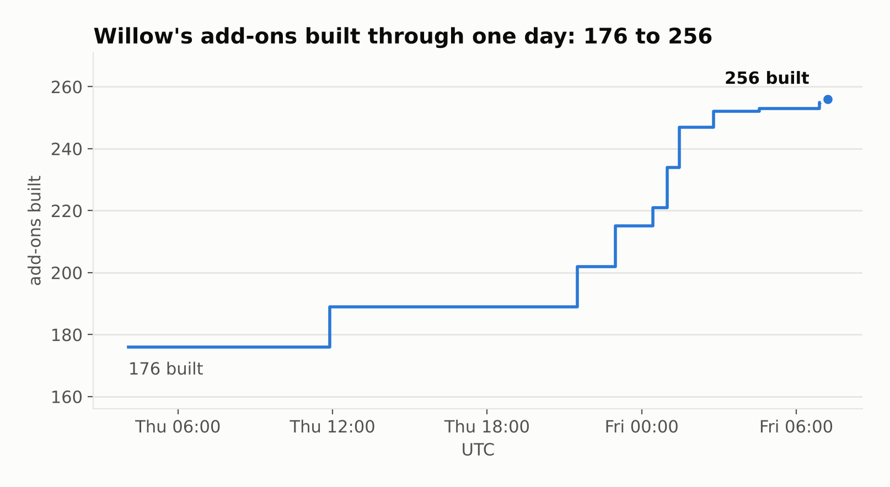
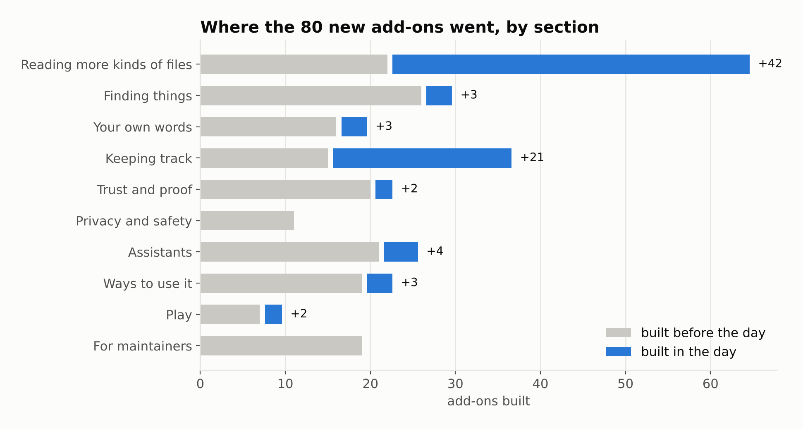
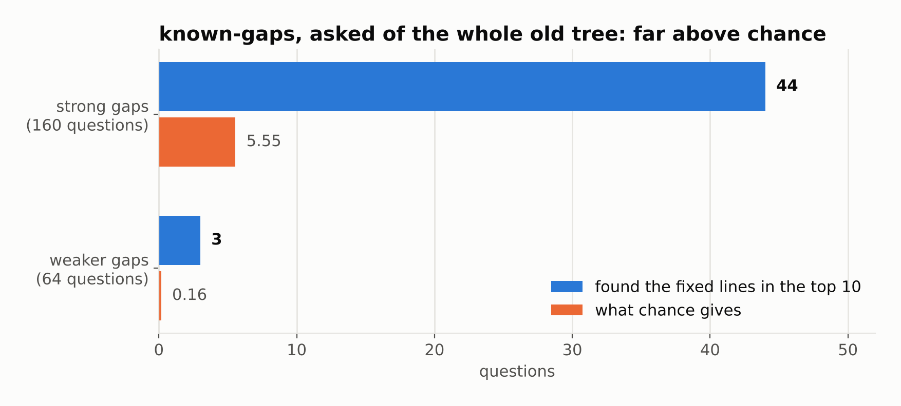

<!--
Desk draft of a DEV post, 2026-10-30, session 015R6z6j5NgirQsSDf27XKub. Written in the operator's
register; not the operator's words until they rewrite or approve it. The operator: "I think i want
to merge all into one post. It was one days worth of work", then "New single post, build on 170,
stop at 100". It replaces two drafts: posts/invitation.md (merged as PR 168 and 169, never
published) and posts/klingon.md (PR 170's first draft, folded in here and removed).

Title options (the operator picks):
1. One day of Willow: 80 add-ons, a language, and a goodbye
2. Make it so: one day, one kernel, and a fan's files about Patrick Stewart
3. Come build on a kernel that won't guess
4. Kernel, kernel, colonel, kernel: a day of Willow
Tags proposed: python, opensource, startrek, showdev.

The day: 2026-10-29 07:00 UTC to the merge of willow-memory/Willow PR 100 (2026-10-30 07:13 UTC,
main at eaa88b2). Willow PR 110, open at drafting, is left out by the operator's word.

Sources (each checked 2026-10-30):
- Counts: ADDONS.md on Willow main's first-parent line. e3fb64e (PR 72's merge, the last on
  main before 2026-10-29 07:00 UTC) says "176 of 470 built"; eaa88b2 says "256 of 474 built".
  The new folders by git ls-tree between them: 69 in adapters/stdlib and 11 in adapters/deps,
  80. git log e3fb64e..eaa88b2: 144 non-merge commits; git diff --shortstat: 367 files,
  43,221 lines added. (An earlier draft started from c8d4c43, a commit on a PR branch, not on
  main, and said 189, 67, 129 and 38,000; drawing figure 1 from main's line caught it.)
- Figures: one-day-figures/make_figures.py regenerates all three from a Willow clone: fig1 the
  built count at each first-parent commit, fig2 ADDONS.md's pools table at e3fb64e and
  eaa88b2, fig3 known-gaps' gate table, copied as published.
- Merged in the window (GitHub search, org willow-memory): Willow 73-83, 88, 92, 97-100 (17);
  willow-bot 174 and 176, with releases 175 (1.23.0) and 177 (1.24.0); willows-grove 168 and
  169. willow-mcp and forge-play/Forge: none merged.
- Add-ons named in the post are folders in that list: slack, discord, matrix, mastodon, irc,
  reddit, x-archive, notion, trello, jira, joplin, goodreads, letterboxd, family-tree, musicxml,
  screenplay, bank, budget, orders, subscriptions, livestock, hook-guard, ripgrep, ocr, pgp,
  static-search, words-tlh, make-it-so, lesson-time, pair-drift.
- README: "What it is not" from Willow README.md at eaa88b2 (PRs 76 and 78).
- known-gaps: demo/known-gaps/README.md at eaa88b2 (PR 74): twelve gaps; phase 1 failed
  (bm25 strong p = 0.787, weaker p = 0.997), phase 2 passed (strong 44 of 160 in the top 10
  against 5.55 expected, p = 5.6e-30; weaker 3 of 64 against 0.16, p = 5.6e-4).
- CI: CHANGELOG.md at eaa88b2, PR 97 ("72 of a pull request's 84 jobs", "14 to 21 minutes").
- Front doors: Willow issues 84-87; PR 92 (the form, the Languages table, packs from their
  folders); PR 98 (seven example stacks: choir, comeback, foster, maintainer, reporter,
  smallholding, teacher); willow-bot PRs 174 and 176.
- The kernel's rule (half the question's content words) and "a third of the words, or any two":
  Willow AGENTS.md, "The kernel's rank is for answering".
- Patrick Stewart died 2026-10-28 at home in Los Angeles, aged 86; announced 2026-10-29. NPR
  (npr.org/2026/10/29/1230906945/patrick-stewart-dead), Deadline, CNN, Variety, ABC News, TIME,
  read 2026-10-30. The post says only what they report.
- Picard as Arbiter of Succession for the Klingon Empire: Star Trek: The Next Generation,
  "Reunion" (season 4, episode 7). claim-check found it in no file of the sources box, so it
  was looked up, 2026-10-30: en.wikipedia.org/wiki/Reunion_(Star_Trek:_The_Next_Generation),
  memory-alpha.fandom.com (Klingon Civil War), tor.com's 2012 rewatch of "Reunion". K'mpec
  makes Picard Arbiter; the Arbiter names the two strongest candidates, who then fight.
- words-tlh: Willow PR 88 at 466404b (description, card, code, tests): 27 words, 37 forms; the
  two-sources rule; boQwI' data at commit 0f6018e (Apache-2.0), Wikipedia "Klingon grammar" at
  revision 1333803070, Wikibooks "Klingon/Grammar/Questions" at revision 4446920; net,
  'arlogh, luq and lu' left out; chay/chay'; the KLI page not counted because its bytes change
  on every fetch; Okrand named, never fetched or copied; q/Q, homonyms, apostrophes, affixes.
  "13th language pack": the 12 codes in test_contract.py before it.
- The English baseline (63 questions over the four demo lives served the same through
  words-tlh) and the eleven overlapping forms: the desk's run on Willow main 2075a9f,
  2026-10-30, kept in the session's scratchpad, not in a repo.
- The study: Willow PR 100, demo/stewart-crossover/README.md, questions.json and the make-it-so
  card, read at 2587221 and unchanged at the merge. Eight sources; seven facts in two
  publishers; two quotes; five traps; five beats; eighteen rules; three freezes; run 1 15 of 17,
  run 2 16 of 18, run 3 18 of 18. "Make it so" starts at character 503 of a 542-character CNN
  line. "Cause Of Death Revealed" is the README's own example of a rotating sidebar.
- "Keep it in, if Gerald shows up, we're on the right track": the operator, quoted in the
  study's README.
- Known bugs: BUGS.md at eaa88b2, #89 to #96 (no #92: that number is the language PR).
- Both jokes are the operator's, from this session.
- Voice: the operator asked for "a more technical read, but with my humor still mixed in", using
  rudi193-cmd/DispatchesFromReality (330dfb6) "for a better read". Its four essays, boxed with
  Willow's kernel and scored by reading-level once their long lines were folded, run 57 to 67
  at 15.8 to 19.3 words a sentence; this post's prose, code and tables left out, scores 70 at
  15.9 (it was 79 at 10.0). "Nobody Adds It Up" (essays/nobody-adds-it-up/README.md, line 11)
  gives the five questions and "Nothing on that list scored a 5."; claim-check and quote-check
  found both.
- The 47 lines past 500 characters: awk over DispatchesFromReality's essays/*/README.md at
  330dfb6. The quote-check result, missing in the raw box and verbatim once folded: the desk's
  run, 2026-10-30.
- Code: copied from Willow at eaa88b2, each block's lines as they are there (kernel.py 85, 494,
  101, 410; test_kernel.py 714-722; words_tlh.py 34-39); a "..." gap is left as a blank line.
- The make-it-so run: real, on Willow main eaa88b2, 2026-10-30, on demo/odile's life made by
  make_life.py; the box and plan paths are shortened to odile-record and plan.json. The
  "changed:" run is on a copy of her files with one line added to the county letter.
- Receipts: deep-links (Willow add-on) on a box of the repo's files at eaa88b2 gave each claim's
  file and lines; they are written as GitHub ?plain=1#L line anchors, since GitHub renders
  Markdown and a text fragment of the raw line would not match what it shows.

Checked with Willow's own add-ons, on main eaa88b2, 2026-10-30 (the session's scratchpad holds
the boxes): quote-check found all 13 of the post's quotes verbatim in a box of its sources;
claim-check found every factual claim whole in one source passage, but for Picard as Arbiter
(sourced above since); reading-level scored every section "fairly easy" or "easy" (the operator then
asked for the level "up a bit", read by the desk as fuller sentences, 70% sure: the whole
post went from 79 at 10.2 words a sentence to 74, "fairly easy", at 14.7; the hardest section,
"27 words of Klingon", is 67, "plain", at 19.3); duplicates found no passage said twice;
a11y-check found no screen-reader problem. One paragraph ran past 500 characters, where the
kernel stops reading (bug #89); it is split.
-->


# One day of Willow: 80 add-ons, a language, and a goodbye

> *Shaking hands:* kernel, kernel, colonel, kernel.
>
> Only one of them gives orders, and it isn't the one in this post.

*For Patrick Stewart, 1940–2026.*

## One day

This is one day of work on Willow, measured the only way I trust anymore: by what landed on `main`, from Thursday morning to Friday morning, UTC.

| | |
|---|---|
| Add-ons built | **176 → 256** (80 new) |
| Pull requests merged | 21, across three repositories |
| Commits | 144 |
| Lines added | about 43,000 |
| Known bugs written down as tests | 7 |
| Languages Willow reads | English, plus 13 packs (one of them new: Klingon) |

It started as an ordinary building day, the kind where the interesting decisions are about file formats, and it turned into something else partway through, when the news came that Patrick Stewart had died.



## The kernel, and what grows from it

Willow is two things, and the split between them is the whole design.
**The kernel** is a single Python file, `kernel.py`, standard library only, with no network code at all and a test that fails the build if any ever appears.
You point it at a folder and ask a question; it answers with up to three passages from your own files, each carrying its file and line number, or it tells you, plainly and without apology, that your files don't hold the answer.
Anything suggested by an AI model, a script or another person is held until you approve it with your key, and every step is appended to a hash-chained log you can verify later.

Retrieval systems usually fail toward confidence.
This one fails toward silence on purpose: the kernel serves a passage only when it holds at least half of the question's content words.
Loosen that to a third of the words, or to any two, and recall improves a little, while the rate of confident answers to questions about something else entirely goes up several times over.
So the threshold stays where it is.
It is the `ESCALATE` answer from my benchmark series, compiled into the retrieval path, and the entire rule is one constant and one comparison:

```python
# kernel.py
HOLD = 0.5  # the share of a bite's words a chunk must hold

    return [(c, d, h) for c, d, h in held if len(h) >= HOLD * len(want)]
```

**The add-ons** are everything else, and the dependency arrow points one way.
An add-on imports the kernel; the kernel never names an add-on, so you could delete every one of them and it would run byte-for-byte as before.
If that sounds like a sovereignty argument, it is one: in [Nobody Adds It Up](https://github.com/rudi193-cmd/DispatchesFromReality/blob/main/essays/nobody-adds-it-up/README.md) I ran twelve popular products through five questions (no account, no server, no subscription, readable data, survives the vendor going away), and nothing scored five.
A single file you can copy anywhere is my attempt at an honest five.

The day's README rewrite led with that split, and added a short section on what Willow is *not*:

- Not a RAG framework that tries to do everything for you.
- Not a system that generates answers: it quotes your files, and anything an assistant suggests waits for you.
- Not something that needs a server, an account or an API key.
- Not a project that hides its rules.

## 80 add-ons

Most of the day went into building, in pull requests of thirteen add-ons at a time.
Each add-on is a folder with its code, its tests and a card declaring what it writes and whether it ever touches the network, and CI runs every add-on's tests under a guard that holds each write to that card while the tests run, not just in review.

- **Your conversations**, from Slack, Discord, Matrix, Mastodon, IRC, Reddit and X archives, become plain text the kernel can search.
- **Your tools and lists**, from Notion, Trello, Jira and Joplin exports to Goodreads and Letterboxd, arrive the same way, along with stranger shapes: family trees, MusicXML scores and screenplays.
- **Keeping track** covers bank statements, budgets, orders and subscriptions, and, because someone will need it, livestock.
- **Programs it can call** include ripgrep for very large folders, OCR for photographs of letters, PGP signatures and a static search page. Ripgrep's hits are checked against the kernel's own passages, so a faster tool can't quietly answer something the kernel wouldn't.
- **Guards** include `hook-guard`, which refuses, by rule rather than by judgement, any AI assistant's tool call that would read your key or write the record behind the kernel's back.



Most of the growth went into reading more kinds of files, which is the part of Willow that decides how much of a life it can actually see.
CI got cheaper as well: six Python versions accounted for 72 of a pull request's 84 jobs, so a pull request now tests on the oldest and newest interpreters, and `main` still runs all six.

## A study that half failed

One of the day's studies pointed Willow at its own fleet's twelve known security gaps.
Each question was written from the gap's original description and asked of the code as it stood just before the fix, to see whether the retrieval tools could find the code the fix went on to change.

Asked of the whole old codebase, they could, and well above chance: 44 of 160 questions put the fixed lines in their top ten, where a random ranking gives about 5.5.
Asked to rank the changed passages against each other, though, they did no better than shuffling.



The README reports both halves, failure first.
The questions were frozen before any of them was asked, which is what makes the failed half a result instead of an embarrassment to be quietly tidied away, and it would be dishonest to show you only the bar that went up.

## Patrick Stewart

Partway through the day the news came that Patrick Stewart had died, at 86.
I wanted to build something in his memory, and the first thing it needed turned out not to be his at all, but a language.

Captain Picard spent a good part of his career among Klingons, and was once made the Klingon Empire's Arbiter of Succession, the outsider who rules on who may fight to lead it.
If a demo was going to ask questions of that world, the kernel would have to read a question asked in Klingon, and it had no idea how.

### 27 words of Klingon

The kernel already discards English function words such as "when", "is" and "the" before it matches anything, but a question in any other language keeps every word it has.
Ask *nuqDaq 'oH yIH'e'?* ("where is the tribble?") and the words for "where" and "it" count toward the match, and since nearly every Klingon passage contains them, the kernel would cheerfully serve you noise.

`words-tlh` strips Klingon's function words first, so the kernel is asked only "yih", the tribble, which is the one word in the sentence carrying any information.
A question made of nothing but function words is refused with "name the thing you mean", which is also good advice outside of Klingon.

Klingon has few speakers to consult and its core reference is a book still in print, so the inclusion rule was strict: **a word goes on the list only where two pinned sources agree on its spelling and its meaning.**
The 27 that passed are the whole list:

```python
# adapters/stdlib/words-tlh/words_tlh.py
SPELLED = (
    "jIH SoH ghaH 'oH maH tlhIH chaH bIH 'e' "
    "je joq ghap 'ej qoj pagh 'ach 'a "
    "nuq 'Iv nuqDaq ghorgh qatlh chay' 'ar "
    "HIja' HISlaH ghobe'"
).split()
```

The sources were the boQwI' dictionary data, Wikipedia's article on Klingon grammar and Wikibooks' page on Klingon questions, each pinned by address and SHA-256 hash, with none of their text copied.
Marc Okrand's *The Klingon Dictionary* is named and never copied.
Four words that only one source contained were left out, and the Klingon Language Institute's own page couldn't be counted at all, because its bytes change on every fetch, which is a hard property to pin a hash to.

The kernel doesn't change for an add-on, so a Klingon question pays for a few English assumptions, and the pack's card itemises the bill:

- **q and Q are different letters in Klingon**, but the kernel lowercases everything, so dropping `qatlh` ("why") also drops `Qatlh` ("be difficult").
- **Homonyms travel together**: `jIH` means "I", and also "viewing screen".
- **The apostrophe is a letter in Klingon**, and the kernel's tokenizer splits on it, so `Qapla'` is read as `qapla`.
- **Klingon is agglutinative**, so `yIH` won't find `yIHmey`, "tribbles", without a words list saying they're the same.

Across Willow's four other demo lives, all 63 English questions returned identical passages with the pack as without it.
Eleven Klingon words are also English words the kernel keeps, among them `e`, `iv` and `oh`, so the pack is for questions asked in Klingon; ask about "vitamin e" through it and you lose the e.

No Klingon speaker has reviewed the list yet. If you are one, it is 27 words long, and I would like to hear what's wrong with it.

### A fan's files beside his life

Then came the demo itself, a study called `stewart-crossover`, which sets a fan's files beside the real record of a few years of his life, 2020 to 2023: the three seasons of *Star Trek: Picard* and his memoir, *Making It So*.

The fan is Wren Castellano, and she is fiction; every one of her files says so on its first line.
He is not fiction, so nothing about him is invented.
Her files end on 22 October 2026, six days before he died, and the study asks a single question of them:

**Can every word about him in her files be shown to come from a source, with whatever the sources don't hold shown as not held?**

- **Eight sources** are pinned by address, time and SHA-256, never by their text. A news page is held by its article's own lines, because its sidebars change by the hour; one of them was rotating a "Cause Of Death Revealed" headline, which is not a line you want your provenance hash to depend on.
- **Everything was frozen first**: seven facts that two publishers must each hold, two quotes, five planted traps, five beats and eighteen pass rules, all committed before any of it was asked. That commit is the pre-registration.
- **Five repositories** each did a part: Willow's kernel and add-ons, willows-grove's checks on a sentence, willow-mcp's list of trusted hosts, willow-bot's own kernel verifying the record, and Forge's rule that anything nothing measured is unseen, never sound.

Five traps were planted in her files, and each was caught by the check named for it:

| Trap | In her files | Caught |
|---|---|---|
| A friend's wrong fact | *Making It So* as "a 2021 memoir" | No source has it; the memoir is from 2023. |
| A misquote | "the line between Jean-Luc Picard and Patrick Stewart got thinner and thinner" | No source has it. The closest passage is CNN's, with the real quote: "the distinction … became thinner and thinner". |
| A reseller's claim | "signed by Patrick Stewart (seller's claim)" | No source has it, so the seller's claim stays the seller's. |
| A Klingon case slip | *qapla'*, all lowercase | Found as "same words", never verbatim: the q/Q cost the card wrote down |
| A wrong birth date | born 13 July 1941 | No source has it; two publishers hold 13 July 1940, in Mirfield. |

Asked in Klingon, *nuq 'oH Qapla'?* went through the pack and was answered from the dictionary's entries.

### Gerald shows up

A parody sits in the pile as well: Sir Patrik Stewpott, "always on a screen, never present".
I kept it in on purpose: *"Keep it in, if Gerald shows up, we're on the right track."*

Asked about Patrick Stewart on a screen, the parody's line ranks first among the seven passages that hold the whole question; asked of the sources alone, nothing holds it.
The kernel can show you the joke, and it can also show you, with a line number, that the joke isn't a source.

### Her files don't know

Asked whether he died, her files hold no passage that says so, and none of their dates falls after 22 October.
They end before the news, and the kernel declines to fill the gap, which is the correct behaviour and, for once, also the kind one.

### Make it so

His most famous line very nearly didn't make it.

"Make it so" appears in CNN's obituary at the end of a 542-character paragraph, beginning at the 503rd character.
The kernel's chunker keeps only the first 500 characters of any line and silently drops the rest, so nothing built on it could find the line, and the first run failed on exactly that.
Two lines of the kernel do it:

```python
# kernel.py
MAX_CHUNK = 500  # characters in one chunk

                para.append(line[:MAX_CHUNK])
```

It is now **bug #89**, and the test that demonstrates it is marked as an expected failure, strictly, so that the day someone fixes the bug the test passes, the strict marker fails the run, and the fix can't slip in unannounced:

```python
# test_kernel.py
@pytest.mark.xfail(
    strict=True, reason="bug #89: a line's text past its 500th character is never read"
)
def test_every_word_of_a_long_line_is_read(tmp_path):
    (tmp_path / "long.txt").write_text(
        "word " * 110 + "the tribble is in the airlock.\n"
    )
    read = " ".join(c["text"] for c in k.chunks(tmp_path))
    assert "airlock" in read
```

The kernel was not patched to make the study pass.
Instead the study fetches long lines as separate sentences, every word kept, and documents why.
(When I later boxed my own essays with the same kernel, 47 of their paragraphs ran past 500 characters.
Asked for the line *"Nothing on that list scored a 5."* from my own essay, `quote-check` reported it wasn't in the folder; folded into sentences, the same file gave it back verbatim.
Bug #89 had been quietly half-reading me as well.)

It took three runs to hold every rule: 15 of 17, then 16 of 18, then all 18.
Each new freeze changed only what the previous run had shown to be broken, none loosened a rule, and runs 1 and 2 stay in the repository beside run 3, failures included.

The demo also brought an add-on named after the line, `make-it-so`.
You give it an order and the question the order rests on; it writes the order down with the supporting passages and the SHA-256 of every file it cites, and then it stops.
**It never carries the order out.**

Later, `check` tells you whether those files still hold what they held, so that a plan made on Monday isn't executed against Thursday's files by accident.
Here it is on Odile, one of Willow's invented demo lives, who has a county notice with a deadline sitting in her mail:

```
$ python adapters/stdlib/make-it-so/make_it_so.py plan --box odile-record --to plan.json \
    --cmd "draft a reply to the county notice" --limit 2 "county notice deadline"
order: county notice deadline
command (not run): draft a reply to the county notice
  mail/2026-03-20-county.txt:12  The proposed determination limits the above well to in-house
  mail/2026-03-20-county.txt:10  NOTICE OF PROPOSED DETERMINATION OF WATER RIGHT
wrote plan.json; nothing was run. The command is yours to run.

$ python adapters/stdlib/make-it-so/make_it_so.py check --box odile-record plan.json
holds
```

Add one line to that letter and the order no longer stands:

```
$ python adapters/stdlib/make-it-so/make_it_so.py check --box odile-record plan.json
changed: mail/2026-03-20-county.txt
the plan no longer holds: 1 of 1 files differ
```

A captain gives the order, and someone else carries it out.
In Willow, code can search, suggest and record, but only a person acts.

## What broke

A day like this turns things up, and the useful response is to write them down where they can't be forgotten.
Seven known bugs went into the repository as strict expected-failure tests, so each one stays visible until it's fixed and announces itself when it is:

| Bug | What goes wrong |
|---|---|
| #89 | A line's text past its 500th character is never read |
| #90 | A search of the folder holding the key is allowed |
| #91 | A command that runs the kernel's seal is allowed, and seal reads the key |
| #93 | `amounts` drops a scale word, so $5 billion and $5 million both print as $5 |
| #94 | `stack` counts an add-on's "none found" as a flagged step |
| #95 | A date inside a web address dates the line around it |
| #96 | `propose` exits 0 when every suggestion is refused |

Two of them, #90 and #91, concern the key, the one thing no code is ever supposed to touch.
Finding them in your own guard is uncomfortable; finding them in someone else's breach report later would be worse.

## Come build

By the end of the day Willow had four front doors, each an issue that explains how to start:

- **[Add your language (#84)](https://github.com/willow-memory/Willow/issues/84).** There is a form now, and you don't need to write Python: bring the common words, what your language does that English doesn't, and where your list comes from, and someone can wrap it into a pack with your name on it. ADDONS.md keeps a generated table of the 13 packs built so far and the ones still waiting.
- **[Build an add-on (#85)](https://github.com/willow-memory/Willow/issues/85).** 218 ideas are listed and waiting, and a draft pull request that names one is how you claim it.
- **[Build a demo from a real situation (#86)](https://github.com/willow-memory/Willow/issues/86)**, whether an invented life like the four already there or a study on public sources like the one above, but never your own private files.
- **[Show your stack (#87)](https://github.com/willow-memory/Willow/issues/87).** Tell us which add-ons you run and what's missing; seven example stacks are there to start from: choir, comeback, foster, maintainer, reporter, smallholding and teacher.

The bot behind the repository helps too: a new idea or language issue gets its entry for the list written out, ready to paste into a pull request, although the bot never opens the pull request itself, for the same reason `make-it-so` never runs the command.

The kernel stays put. The rest is yours to grow.

- The repo: [willow-memory/Willow](https://github.com/willow-memory/Willow)
- Every add-on, built and planned: [ADDONS.md](https://github.com/willow-memory/Willow/blob/main/ADDONS.md)
- What it falls short of: [LIMITS.md](https://github.com/willow-memory/Willow/blob/main/LIMITS.md)
- The longer argument for software you can keep: [Nobody Adds It Up](https://github.com/rudi193-cmd/DispatchesFromReality/blob/main/essays/nobody-adds-it-up/README.md), and the systems behind it in [Case Study 4](https://github.com/rudi193-cmd/DispatchesFromReality/blob/main/professional/one-script-fleet-case-study.md)

**Receipts.** Every number above is a line in the repo, at the commit this post describes:

- [256 add-ons built of 474](https://github.com/willow-memory/Willow/blob/eaa88b2/ADDONS.md?plain=1#L20-L21)
- [half the question's content words](https://github.com/willow-memory/Willow/blob/eaa88b2/AGENTS.md?plain=1#L133-L135)
- [44 of 160 against 5.55 by chance](https://github.com/willow-memory/Willow/blob/eaa88b2/demo/known-gaps/README.md?plain=1#L447-L452)
- [27 words, 37 forms](https://github.com/willow-memory/Willow/blob/eaa88b2/adapters/stdlib/words-tlh/README.md?plain=1#L23-L29)
- ["Make it so" at character 503](https://github.com/willow-memory/Willow/blob/eaa88b2/demo/stewart-crossover/README.md?plain=1#L213-L219)
- [All 18 rules held](https://github.com/willow-memory/Willow/blob/eaa88b2/demo/stewart-crossover/README.md?plain=1#L274-L276)
- [Gerald first of seven passages](https://github.com/willow-memory/Willow/blob/eaa88b2/demo/stewart-crossover/README.md?plain=1#L278-L286)
- [bug #89 and the rest](https://github.com/willow-memory/Willow/blob/eaa88b2/BUGS.md?plain=1#L9-L17)
- [make-it-so never runs the command](https://github.com/willow-memory/Willow/blob/eaa88b2/adapters/stdlib/make-it-so/README.md?plain=1#L47-L48)
- [`HOLD = 0.5`](https://github.com/willow-memory/Willow/blob/eaa88b2/kernel.py#L85) and [the comparison that uses it](https://github.com/willow-memory/Willow/blob/eaa88b2/kernel.py#L494)
- [`MAX_CHUNK = 500`](https://github.com/willow-memory/Willow/blob/eaa88b2/kernel.py#L101) and [the line that cuts](https://github.com/willow-memory/Willow/blob/eaa88b2/kernel.py#L410)
- [bug #89's strict test](https://github.com/willow-memory/Willow/blob/eaa88b2/test_kernel.py#L714-L722)
- [the 27 Klingon words](https://github.com/willow-memory/Willow/blob/eaa88b2/adapters/stdlib/words-tlh/words_tlh.py#L34-L39)

---

*A colonel, a corn kernel, and an operating-system kernel walk into a bar.*

*The bartender asks what they'll have.*

*The colonel orders for everyone without consulting the table.*

*The corn kernel claims kinship and asks for bourbon.*

*The computer kernel considers the question for a long time.*

*"I can't," it says at last. "Nothing present contains half the words."*

*The bartender sets a glass of water in front of it anyway.*

*The kernel holds the glass carefully and waits for the key.*
